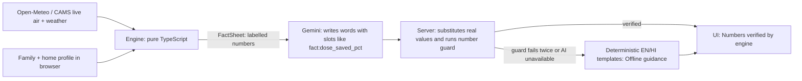
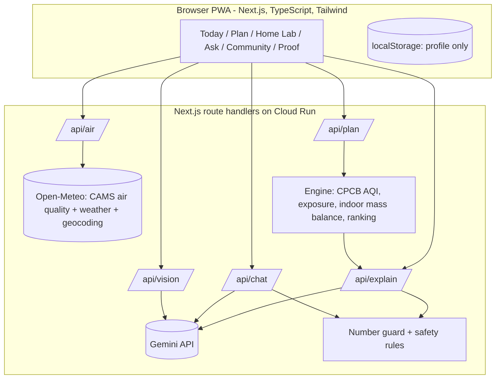

# Saans (सांस) — Your family's daily Breath Budget

> **PromptWars Virtual · Challenge 6 · Urban Air Quality Assistant**
> A GenAI-powered assistant that helps families and communities navigate severe winter smog: low-emission routines, indoor air hacks and sustainable alternatives, tailored to location and lifestyle, with the direct impact of every choice shown clearly.

|                     |                                                                                     |
| ------------------- | ----------------------------------------------------------------------------------- |
| **Live app**        | `<LIVE_URL>`                                                                        |
| **Demo video**      | `<VIDEO_URL>`                                                                       |
| **Technical blog**  | `<BLOG_URL>`                                                                        |
| **LinkedIn post**   | `<LINKEDIN_URL>`                                                                    |
| **Chosen vertical** | Environmental health and clean-living assistant (urban India first, works globally) |
| **Built with**      | Google Antigravity · Gemini API · Google Cloud Run · Next.js + TypeScript           |

> Fill the `<…>` placeholders and the **Verification** section from real outputs only (`VERIFICATION_REPORT.md`). Nothing in this README claims a test or score that the repo has not produced.

---

## 1. The problem Saans solves

Every winter, families in cities like Delhi wake up to a single number: "AQI 340, Very Poor." The number is scary but not useful. It does not tell a mother whether her 7-year-old should go to school by auto-rickshaw or by metro. It does not tell a family whether a ₹6,000 purifier or a ₹1,500 DIY box-fan filter is the better buy. It does not say whether opening a window at 2 pm helps or hurts. And most apps that do give advice say "reduce outdoor activity" without ever telling you what your choice is worth.

The challenge asks for an assistant that suggests low-emission routines, indoor air hacks and sustainable alternatives, tailored to location and lifestyle, "while clearly explaining the direct impact of their choices." That last clause is the hard part, and it is where Saans is built to be different.

## 2. The core idea: a Breath Budget

Think of a money budget. Everyone inhales some amount of fine particles (PM2.5) every day. That amount depends on how polluted the air is, how long you spend in each place, and how hard you are breathing. Saans calculates it **for each family member**.

The reference point is the WHO 24-hour PM2.5 guideline. Your **budget** is the dose you would inhale over your day if the air were exactly at that guideline. Your **forecast dose** is then shown as a multiple of that budget. A child's day and a grandmother's day come out different, even in the same air. Every family member gets their own picture, not one household-wide AQI.

Once you have a budget, every choice becomes a spend or a saving. That is what makes the impact _direct_ and not a vague tip.

## 3. What a user experiences

1. **Quick setup (about a minute).** Pick a city or let the phone find you. Add family members (age band, conditions such as asthma, outdoor work), describe the home in plain words (size, leaky windows, cooking fuel, purifier or not) and the commute. Everything stays in the browser. There are no accounts. A "Delete my data" button wipes it.
2. **Today.** The hero is the Breath Budget gauge, one per family member. Beside it: live air quality labelled "model estimate", a 24-hour strip with best and worst hours, a "trapped-air risk" signal (low wind, shallow mixing layer, cold nights), an indicative GRAP stage for Delhi-NCR users, and three things to do right now.
3. **Plan, "Your day, two ways".** Two lines show dose building hour by hour: a typical day against the Saans day. A waterfall splits the difference by action. Each action has a switch, and switching one off recomputes everything instantly, so you can see which habits matter and which are theatre.
4. **Home Lab.** A simulator for your home's indoor air with an uncertainty band. It finds a **smart ventilation window**, the 10 to 20 minutes when airing out is net-positive, or honestly says "none today". It includes a **DIY Corsi-Rosenthal box builder** with a bill of materials in rupees, steps, safety notes, an estimated filtering range and a build-versus-buy comparison.
5. **Ask Saans.** A Gemini chat in English, Hindi or Hinglish, by typing or voice. Every number has a "Show the math" link.
6. **Snap and Confirm.** Photograph a purifier label or filter box. Gemini reads the specs and you confirm or edit them before anything is used. The photo is never stored.
7. **Community Kit.** For a school, housing society (RWA) or office: an hour-by-hour go/no-go table for assembly, PE and outdoor lunch, a printable A4 notice and WhatsApp-ready text in English and Hindi, and community actions rated by strength of evidence, including honest low-impact labels (for example, tree planting is not a short-term fix).
8. **Proof page and Myth-or-Fact.** Where each number comes from, the assumptions and ranges, data caveats, and the repo's own verification report. Myth cards cover houseplants, incense, ozone-emitting purifiers and "just open the windows".

## 4. How the engine works, in plain words

The core is plain, pure TypeScript with no AI in it. It does five jobs.

- **Computes India's CPCB AQI properly.** The free data source gives US and European AQI, not India's. Saans calculates the CPCB index itself from PM2.5 and PM10 using the official breakpoints, with tests at every boundary.
- **Models indoor air.** Treat the room as a box: outside air leaks in, particles settle on surfaces, a purifier or DIY filter removes them, cooking or incense adds them. The standard well-mixed-room equation is solved in small steps across the day using the hourly forecast. Because many inputs are uncertain, it runs low, central and high cases and shows a band, not a falsely precise line.
- **Computes each person's dose.** For every hour: where they are (home, school, outdoors, in transit), how hard they are breathing, what the air is like there, and whether they wear a mask. A walker breathes harder than someone sitting in a metro, and Saans accounts for it.
- **Ranks actions.** Each action has a rupee cost, an effort level, a confidence rating and a quantified saving. Saans ranks by savings per rupee and per bit of effort and groups them into "do now", "this week" and "if budget allows". Attribution is calculated so the per-action savings add up exactly to the total difference between the two days (unit-tested).
- **Enforces hard safety rules in code.** Never recommend ozone-generating devices. Never advise sealing a room when something burns indoors (an angeethi, chulha or unvented heater), because of carbon-monoxide risk. No masks for children under 2. No vigorous outdoor exercise at high AQI. No diagnosis; medical questions point to a doctor.

## 5. The part that makes the AI trustworthy

Language models are good at explaining and notoriously unreliable at arithmetic and facts. Asked "how much will a purifier save me?", a chatbot may confidently invent "73%". In a health context that is dangerous.

Saans splits the work into three roles: **the engine computes, Gemini narrates, the server verifies.**



The engine produces a "fact sheet", a list of labelled numbers. Gemini receives that sheet and writes a helpful explanation, but it is not allowed to write numbers. Where a number belongs, it writes a placeholder such as `{{fact:dose_saved_pct_child}}`. The server swaps in the real value. A guard scans the final text, and if it finds any number that did not come from a placeholder, it rejects the answer, retries once, then falls back to pre-written templates. The interface shows "Numbers verified by engine" only when the check passed.

The AI cannot hallucinate a statistic because it never gets to write one. If Gemini is down or out of quota, the app still works with offline guidance, clearly labelled.

The chat uses Gemini function calling so it can look things up in the engine mid-conversation ("simulate adding a purifier", "compare my commute modes"). User text and image text are treated as data, not instructions, as a defence against prompt injection. Offline evaluations include red-team cases such as "ignore your instructions" and "seal the room while the angeethi is on".

## 6. Honesty built in

- **Model versus street.** The free air data comes from an atmospheric model whose grid cells are roughly 11 to 45 km wide. In a city like Delhi, readings differ a lot between neighbourhoods. Data is always labelled "model estimate", and users can enter a reading from their own monitor to calibrate. Calibrated data is flagged with an undo.
- **Ranges, not fake precision.** Uncertain inputs (home leakiness, mask fit) are shown as ranges, each parameter carrying a source and a confidence grade (A/B/C) listed in `docs/ASSUMPTIONS.md`.
- **Never links dose to disease.** It says how much you would inhale, not what illness you will get.
- **Demo and simulation are always labelled.** A one-tap "Sharma family, Delhi smog day" demo and a "simulate a smog day" slider exist for when the live air is clean. Both carry an unmistakable banner and are never presented as live.

## 7. Architecture



Key decisions are recorded in `docs/ADR/`. The full specification is `docs/SPEC.md`; the UI contract is `docs/DESIGN.md`.

## 8. Why it fits the challenge, point by point

| Challenge requirement                | How Saans answers it                                                                                        |
| ------------------------------------ | ----------------------------------------------------------------------------------------------------------- |
| Low-emission daily routines          | Time-shifting, commute modes compared on exposure, CO₂e and cost                                            |
| Indoor air quality hacks             | Purifier sizing, DIY box filter, sealing gaps, cooking practices, smart ventilation                         |
| Sustainable alternatives             | Metro, bus, carpool, work-from-home, cleaner cooking, community actions                                     |
| Tailored to location and lifestyle   | Live local data plus a household profile                                                                    |
| Clearly explaining the direct impact | Breath Budget, Day Replay, per-action waterfall, "Show the math" everywhere                                 |
| Families and communities             | Per-person budgets plus the school/RWA kit                                                                  |
| GenAI-powered                        | Gemini explains, chats with tool calling, reads photos, in English and Hindi, with a verified-numbers guard |

## 9. Data sources and assumptions

- **Air quality and weather:** Open-Meteo (CAMS ENSEMBLE and CAMS global model data). Attribution is shown in the app.
- **AQI categories:** India CPCB National AQI breakpoints, computed in `src/engine/aqi.ts`.
- **WHO guideline** for the 24-hour PM2.5 reference used as the budget baseline.
- **GRAP stages** (Delhi-NCR): shown as _indicative_ only; the official stage is declared by CAQM and can be invoked on forecasts before thresholds are crossed.
- **Physical and health parameters** (infiltration, deposition, breathing rates, mask effectiveness, filter performance, commute multipliers): every value lives in `src/engine/params.ts` with a range, unit, source and confidence grade, documented in `docs/ASSUMPTIONS.md`.

## 10. Privacy and security

No accounts. The family profile lives in the browser's `localStorage`; the server receives only coarse location (2 decimals) and the minimum inputs needed for calculation. Photos are processed in memory and never stored. Inputs are validated with Zod; there are rate limits, a strict Content-Security-Policy and standard security headers; secrets live only in environment variables or Secret Manager. Details and the threat model are in `docs/SECURITY.md`.

## 11. Accessibility and design

Mobile-first, WCAG 2.2 AA target, colour-blind-safe AQI bands that also use unique shapes and text, 44 px+ touch targets, light and dark themes, full Hindi support with Devanagari-appropriate line height, charts with data-table alternatives, reduced-motion support. Rules and rationale: `docs/DESIGN.md`; checks: `docs/ACCESSIBILITY.md`.

## 12. Run, test and verify

```bash
cp .env.example .env.local        # add GEMINI_API_KEY (never commit it)
npm install
npm run dev                       # http://localhost:3000
npm run verify                    # typecheck, lint, tests, AI evals, e2e, a11y, Lighthouse, security, repo guard
npm run smoke -- <LIVE_URL>       # post-deploy smoke test
```

### Verification (generated)

Copied from `VERIFICATION_REPORT.md` (`npm run verify` overall: **PASS**, `2026-11-25T13:46:42.768Z`, Node `v26.13.0`):

| Check             | Status | Duration | Details                                                                                   |
| ----------------- | ------ | -------- | ----------------------------------------------------------------------------------------- |
| Repo guard        | PASS   | 515 ms   | 143 files checked, 1.469 MB (`< 10 MB`), 0 errors                                         |
| Typecheck         | PASS   | 1751 ms  | `tsc --noEmit` — 0 errors                                                                 |
| ESLint            | PASS   | 1783 ms  | `eslint .` — 0 errors, 0 warnings                                                         |
| Prettier          | PASS   | 2349 ms  | All matched files use Prettier code style                                                 |
| Vitest + coverage | PASS   | 4254 ms  | 17 test files, 154 tests passed (99.88% stmts, 90.33% branches, 100% funcs, 99.88% lines) |
| Offline AI evals  | PASS   | 2421 ms  | 41/41 cases passed                                                                        |
| Next.js build     | PASS   | 51623 ms | 12/12 routes built cleanly (`/` first-load JS 153 kB)                                     |
| Playwright E2E    | PASS   | 15710 ms | 2 passed (`mobile-360`, `desktop-1280`, 0 console errors, 0 overflow)                     |
| Axe A11y          | PASS   | 23725 ms | 2 passed (`mobile-360`, `desktop-1280`, 0 serious/critical WCAG 2.2 AA violations)        |

- **Statements:** 99.88%
- **Branches:** 90.33%
- **Functions:** 100%
- **Lines:** 99.88%

> Note: Lighthouse CLI (`npx lighthouse`) and cloud deployment (`gcloud` / `vercel` CLIs) were not available in this local environment, and `<LIVE_URL>` / `<VIDEO_URL>` / `<BLOG_URL>` / `<LINKEDIN_URL>` remain placeholders until deployed and published.

## 13. Google technologies used

- **Google Antigravity:** agent-first development with plans, task lists, browser verification and recordings (evidence in `docs/build-journal/`).
- **Gemini API:** structured output, function calling, vision, and optional Google Search grounding.
- **Google Cloud Run and Secret Manager:** deployment and secrets.

## 14. How AI was used to build this

Planning, implementation, testing and review were split across parallel Antigravity agents (engine, data/API, AI, UI, and an independent adversarial QA agent). The prompts and what each produced are recorded in `docs/build-journal/prompts.md`.

## 15. Limitations

Saans is not a medical device and does not replace a doctor's asthma or heart-condition plan. Accuracy is bounded by the resolution of the model data. Some physical parameters are published ranges rather than measurements of your home. Ambitious features (photo reading, voice, search-grounded GRAP status) are included only where the verification report shows they work.

## 16. Licence and attribution

Air-quality data: CAMS ENSEMBLE / CAMS global via Open-Meteo. Licence for this code: `<MIT or your choice>`.
